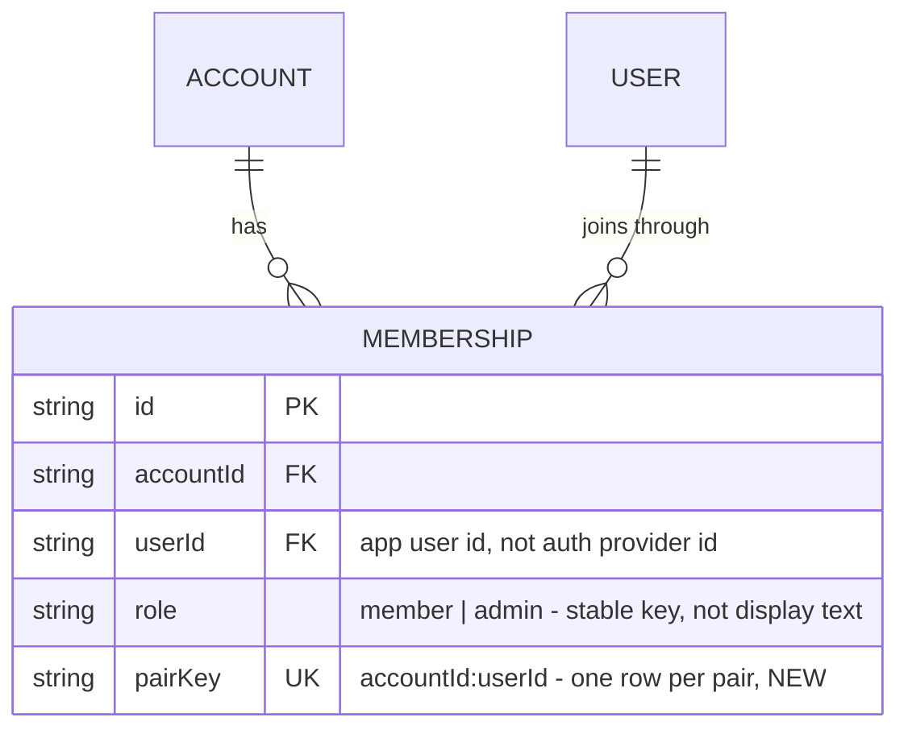

# ERD: get the data model right before anything is built

## Contents

- On UnifyApps
- You carry the model, not the requester
- Step 1 - Ground truth. Never draw from memory
- Step 2 - List the queries before the entities
- Step 3 - Draw it (mermaid erDiagram)
- Step 4 - Interrogate: the seven questions
- Field rules that save a future migration
- Step 5 - Critique mode: verdicts, not vibes
- Extending a live model
- The deliverable
- Red flags - you are about to skip the job

A wrong data model is the most expensive bug you can ship. Wrong code is fixed
in a deploy. A wrong schema is fixed in a migration: a backfill, a risky write
to every row, sometimes downtime. So the model is designed on paper, questioned
hard, and only then built. This skill is that questioning.

It is one method with four entry points:

| you are given | job |
|---|---|
| a PRD or feature request | design the model |
| a database with no diagram | draw the ERD from the real schema |
| a schema or ERD to review | critique it, verdict by verdict |
| a vague idea | brainstorm: ask the questions below, then design |

All four run the same loop: ground truth, then queries, then draw, then
interrogate, then walk it at scale, then verdicts in writing.

## On UnifyApps

For a UnifyApps Storage object, this skill's SKILL.md (the plan) and
`object-storage-manager` (the write) win wherever this skill differs:

- System fields (`id`, `v`, `cTm`, `mTm`, …) already exist; never declare them.
- Money is a `number` field.
- There are no partial or sparse indexes.
- A natural primary key is fine when the domain value is stable and unique.
- Inside a builder agent, ask no questions and write no markdown deliverable:
  a gap is `needs_confirmation`, and decisions go in the report's `notes`.

## You carry the model, not the requester

Assume the person asking has never learned data modeling and does not care
about the diagram. They care that the product works next year. That is fair -
it is not their job. It is yours. So:

- Run the full loop even when the request is one sentence. The requester not
  asking for the seven answers does not remove one of them.
- The diagram is for builders and reviewers. The seven answers are what keep
  the requester safe. Produce both, always.
- Ask questions as product choices in plain words, one line each, with a
  recommended default - never as database jargon. "If a venue is renamed,
  should old tickets show the old name or the new one?" - not "should we
  denormalize venue fields?".
- What they cannot answer, you decide, record as a decision with its reason,
  and flag as reversible or hard to reverse. An unrecorded decision is the
  one that gets rediscovered in an incident.
- Hurry does not shrink the job. The fast version of this skill is the same
  loop with shorter answers, never fewer questions.

## Step 1 - Ground truth. Never draw from memory

Read the real schema before drawing anything: migration files, ORM models, DDL,
or live introspection. Docs and memory both lie; the schema does not.

- A field that exists is drawn exactly as it is, even if you dislike it.
- A field you are proposing is marked `NEW` in its comment. A reader must be
  able to tell truth from proposal at a glance.
- Greenfield (nothing exists yet): the requirement is the input and every
  entity is `NEW`.

## Step 2 - List the queries before the entities

A data model exists to answer queries. So write the queries first: every
screen, list, lookup, report, and write path, one line each - who asks, what
they get, filtered and sorted by what, roughly how often.

This list is the test suite for the model. In document databases it decides the
shape outright (model per query). In SQL it decides the indexes and every
denormalization.

**Cannot list the queries? You are in brainstorm mode.** Ask, then design:

- Who are the tenants? Can data ever cross a tenant line?
- Row counts per entity at launch, and at 10x?
- What must never exist twice? (This becomes the unique keys.)
- What gets deleted - and what must survive that deletion?
- What is searched, and is it text search or exact filters?
- Which values change often, and who displays them?
- What must be kept for audit, and for how long?
- Read-heavy or write-heavy, per entity?

## Step 3 - Draw it (mermaid erDiagram)

- Every attribute has a type. Keys are marked `PK` / `FK` / `UK`.
- Every edge names its cardinality on BOTH ends. Min matters as much as max:
  "zero or one" vs "exactly one" is a design decision, not decoration.
- Many-to-many is never drawn direct. It becomes a junction entity with two
  one-to-many edges - and junctions usually earn their own attributes
  (role, addedAt, addedBy).
- **A link between two entities is a row, never an array of ids on one of
  them.** `project: {campaignIds: [...]}` looks harmless while the array is
  small, but an id inside an array cannot carry anything: no permissions, no
  addedBy or addedAt, no foreign-key check, no index for the reverse question
  ("which projects hold campaign X"), and two writers appending at once lose
  updates. The junction row has all five. Size is not the test - shape is.
- Non-obvious fields get a comment: what it means, which id space it holds,
  what unit it is in.
- Past about 12 entities one diagram stops being readable. Split by domain
  area. Never one giant sheet.

Cardinality glyphs (outer symbol = max, inner = min):

| glyph | meaning |
|---|---|
| `\|o` | zero or one |
| `\|\|` | exactly one |
| `}o` | zero or many |
| `}\|` | one or many |

`--` identifying (child cannot exist without parent), `..` non-identifying.
Attribute line: `type name PK "comment"`.

## Step 4 - Interrogate: the seven questions

No entity ships without all seven answered in writing. An unanswered question
is not "probably fine" - it is where the next incident lives.

| # | question | what goes wrong without it |
|---|---|---|
| 1 | **What makes two rows the same real-world thing?** Name the unique key. | A table with only a surrogate id lets duplicates pile up unseen. If a human could not point at their row without the id, uniqueness is undefined. Beware the optional unique field: some stores treat missing as null and collide two absent values; most SQL lets NULLs repeat - either way it needs a decision (partial/sparse index). And a unique violation at write time is a raw driver error - pre-check and return a clean "already exists". |
| 2 | **For every relationship: what happens when the parent goes away?** | Cascade, restrict, set-null, or orphans - chosen per edge, never defaulted. In stores without enforced foreign keys, application code is the only guard: name it. A junction with no unique key on the pair silently collects duplicate links. |
| 3 | **What is the delete and archive story?** | Soft delete means flag AND timestamp written together, every reader filtering the flag, and a decision on whether deleted rows still block unique values ("unique among not-deleted" needs a partial index). Restore-from-trash needs everything the row pointed at to still exist. |
| 4 | **What do empty, null, missing, and `""` each mean, per field?** | In schemaless stores an absent boolean is not false - it is absent. Blank strings pass many "required" checks and land in foreign keys. Pick one rule per field and write it down; every reader inherits it. |
| 5 | **Walk every query from step 2 against the model, at 10x scale.** | Each query must resolve to a key lookup or an indexed filter - name the index. Estimate the row count per entity and say it out loud. Nothing inside a row may grow with usage (arrays, JSON blobs) - unbounded growth becomes its own entity. No per-item queries in a loop. |
| 6 | **Every copied or derived value names its source of truth and its refresh rule.** | A denormalized copy or stored count with no written refresh rule WILL go stale, and readers will trust it anyway. Copy on purpose only: read often, changed rarely, rule written down. Concurrent counters need atomic increments or compare-and-set, or updates get lost. |
| 7 | **Who owns each row?** | The tenant / account / team key goes on EVERY table from day one - including tables that could derive it by a join. "We can add it later" is a migration with a backfill. Multi-tenant queries filter by owner first, so indexes lead with the owner key. |

## Field rules that save a future migration

- **Ids.** Internal ids never appear in URLs or exports if the thing can be
  renamed or merged - give it a stable public identifier, and keep old ones
  resolvable after a rename. When one concept has two id spaces (auth provider
  id vs app user id), every field's comment says which one it holds. Never
  compare across spaces.
- **Time.** UTC, one representation, everywhere. A calendar date is not a
  timestamp - decide which each field is. Every row carries created and
  updated times.
- **Enums.** Store a stable machine key, display a label. Filtering on display
  text breaks on the first rename or translation.
- **Money.** Integer minor units plus a currency code. Never floats.
- **Text people search.** Keep searchable plain text separate from rich markup,
  or search will match the markup.
- **Names.** One convention for everything: one case style, singular or plural
  but not both, no abbreviations, and reuse the words the codebase already
  uses. Consistency beats the choice itself.
- **One fact, one place.** Normalize by default: every fact lives in exactly
  one field of one entity. Anything stored twice is a copy and must pass
  question 6.
- **States.** A status field is a closed set of stable keys with its allowed
  transitions written down - and each state worth reporting on gets its own
  timestamp (completedAt, cancelledAt), because "when did it reach this state"
  cannot be recovered from the current value.
- **History.** Decide at design time whether changes to this entity need a
  who-changed-what trail. An audit log bolted on later starts empty - the past
  is already gone.

## Step 5 - Critique mode: verdicts, not vibes

Reviewing a model - yours, a teammate's, or one an AI drew - is the same loop
run backwards: score it against the seven questions, then against the smells
below. Every finding gets a written verdict: **fixed**, or **accepted, with
the reason**. "Looks fine" is not a verdict. A finding nobody wrote down will
be re-found in production.

| smell | how it bites later |
|---|---|
| enum stored as display text | the first rename breaks every filter and report |
| two conventions for one kind of value | every reader branches forever; cleanup blocks the next feature |
| one field holding two formats | search and filters match the wrong format |
| internal ids user-facing | renames and merges break every saved link |
| one table for many kinds of things | no real foreign keys, unnatural filters, every query pays |
| display fields copied onto link rows | stale after every rename |
| natural key as the primary key | the value changes, the identity changes, everything pointing at it breaks |
| surrogate key with no unique constraint | duplicate real-world things pile up unseen |
| unbounded array or blob in a row | grows with usage until reads slow and writes hit size limits |
| array of foreign ids instead of a junction row | no permissions, no per-link data, no reverse lookup, lost updates on concurrent writes |
| shared counter without atomic updates | concurrent writers lose updates silently |
| field only some writers fill | readers cannot tell "no" from "nobody wrote it" |

## Extending a live model

A change to a model with data in it answers three more things, in writing:

1. **Existing rows.** Backfill them, or write the rule every reader uses for
   rows where the field is missing. "New rows only" without that rule splits
   the table into two silent generations.
2. **Rollout.** Do old readers and writers still work while the change lands?
   A rename is a migration, not an edit.
3. **The diagram moves in the same commit** as the schema change.

## The deliverable

One committed markdown file next to the code: the diagram(s), the per-entity
seven answers, the query walk, open questions, and the decisions taken with
reasons. From then on it moves in the SAME commit as any schema change - an
ERD that disagrees with the schema is a bug, not a stale doc.

## Red flags - you are about to skip the job

- "I know the schema, no need to read it"
- "We can add the tenant key later"
- "Duplicates are unlikely" - said with no unique constraint
- "The array will stay small"
- "Delete is an edge case"
- "We'll add indexes when it gets slow"
- "The diagram can catch up after we build"

Each of these is the first sentence of a future migration. Answer the seven
questions instead.
